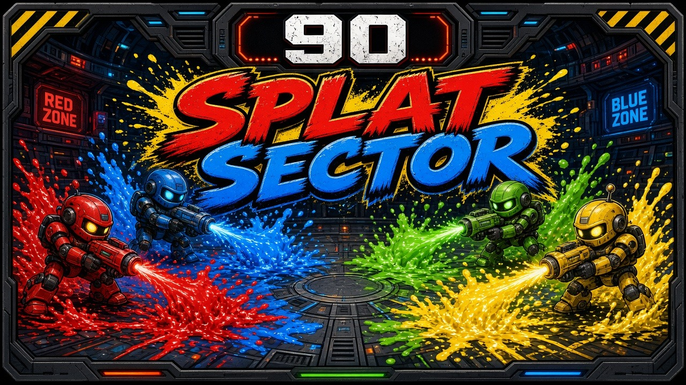

# Splat Sector

Paint the arena your color in 90 seconds. Four rollers share one screen in a free-for-all. Roll over cells to claim them, splash ink to stun, and dash a wide trail through enemy color. The player who owns the most of the floor when the clock hits zero takes the round. First to 3 rounds wins the match.

## Launch

The game is a static page plus a tiny Python server. No install step and no network once you have the files.

- **macOS:** double-click `launch-mac.command`
- **Windows:** double-click `launch-windows.bat`
- **Linux:** `./launch-linux.sh`

Each launcher looks for Python 3 and, if it is missing, prints how to fix that. The server binds to `127.0.0.1` on port **8819**. If that port is taken, it uses the next free port and opens the page in your browser.

You can also start it yourself:

```bash
python3 server.py
```

## Controls

Keyboard works with no gamepads. A connected gamepad in slots 0–3 takes over that player (left stick or D-pad to move, A to shoot, B to dash, Start to pause) and can be plugged in mid-match. Connected pads show an icon on the HUD.

| Player | Move | Shot | Dash |
| --- | --- | --- | --- |
| P1 | W A S D | F | G |
| P2 | Arrow keys | / | . |
| P3 | I J K L | ; | ' |
| P4 | Numpad 8 4 5 6 | Numpad 0 | Numpad Enter |
| Gamepad | Left stick / D-pad | A | B |

Pause with Esc or Start. M mutes. Controls, volume, and the rounds-to-win count can be changed from the pause menu (Tab on the title or join screen). Remaps are saved in `localStorage`.

On the join screen every empty slot starts as a bot. Press that player's shot button to sit down as a human. Press dash to toggle a slot between bot and off. Enter starts the match. One human can play against three bots.

## Rules

The arena is a 64×40 grid with walls. Rolling paints a trail in your color. Your own ink is fast, neutral ground is normal, and enemy ink slows you down. A shot lobs a blob that paints a splash and stuns anyone it catches for 1 second. A direct hit knocks that player out; they reappear at their corner after 2 seconds. Dash paints a wide trail and then waits 4 seconds.

Ink pickups appear on the floor:

- **Bomb** — a large splash that clears nearby rollers
- **Speed** — a short burst of extra pace
- **Inkstorm** — 5 seconds of painting everything around you

## Scoring

The HUD shows a live percentage of the paintable floor for each player, plus rounds won. When the 90-second clock ends, the player with the most painted cells wins the round. Ties go to whoever was knocked out fewer times in that round, then to the lower player number. First to 3 round wins takes the match (you can change that count in settings). The results screen offers a rematch or a return to the title.

## arcade.json

`arcade.json` is the manifest an arcade launcher reads: display name, id `splatsector`, icon, cover, per-OS launch commands, the web entry `index.html`, 4 players, minimum 1, keyboard and gamepad input, and port 8819.

## Tests

Core rules live in `src/core/` with no DOM, so they run in Node:

```bash
node --test tests/*.test.js
python3 tests/server_smoke.py
```

The JavaScript suite covers movement and walls, ink speed, scoring, round and match wins, knockouts and respawns, stuns, dashes, pickups, the seeded RNG, keyboard and gamepad mapping, and the arcade manifest. The Python smoke test starts `server.py` and checks that it serves the page.

## License

MIT. See [LICENSE](LICENSE).
